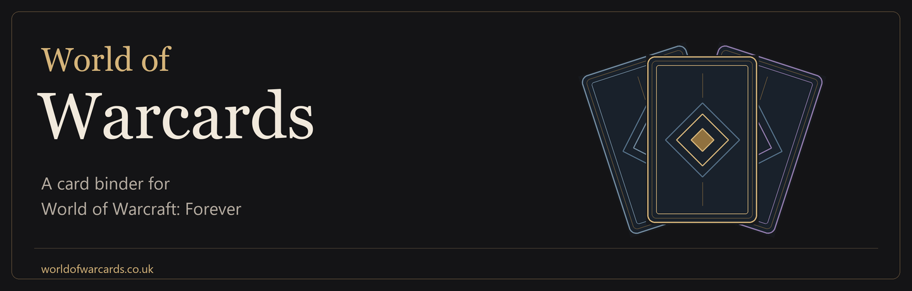
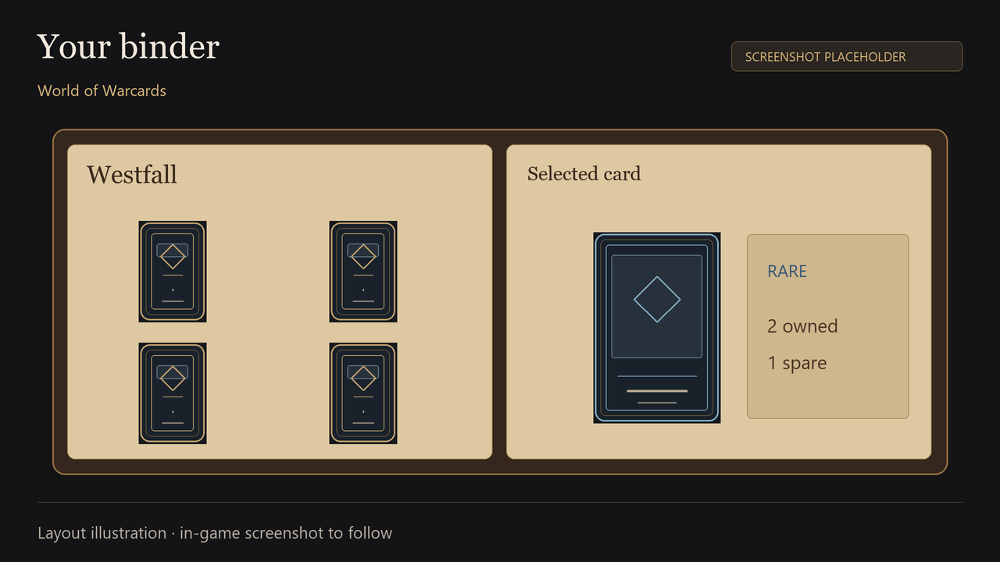
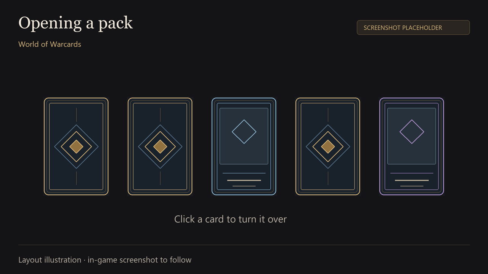
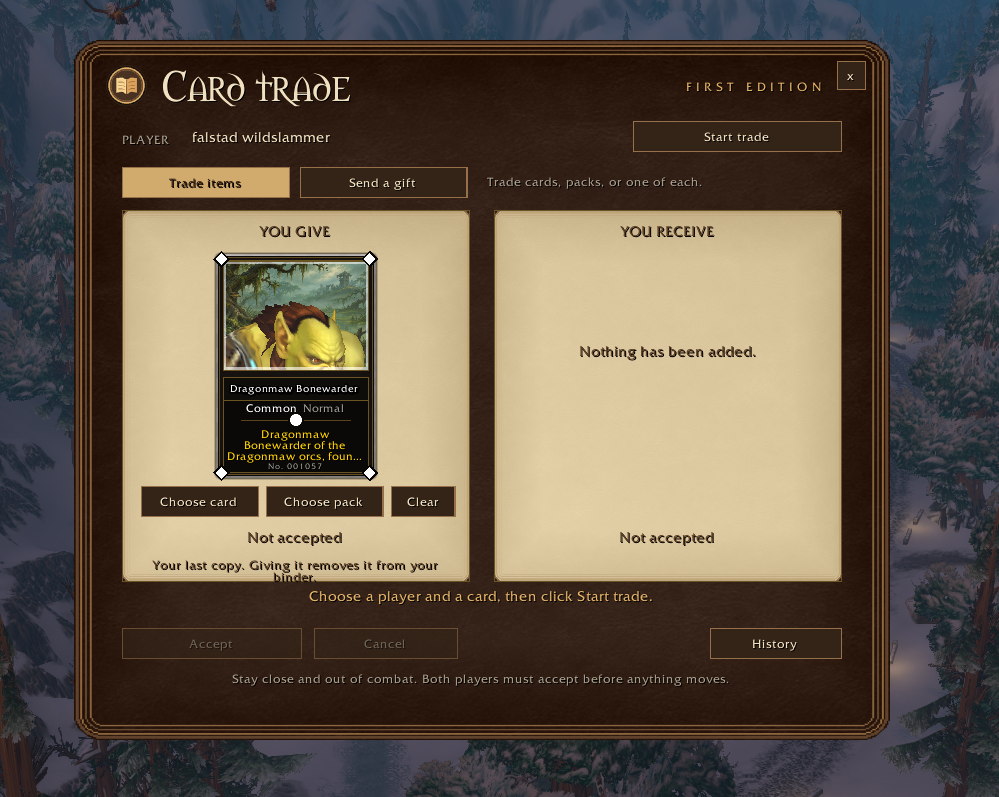
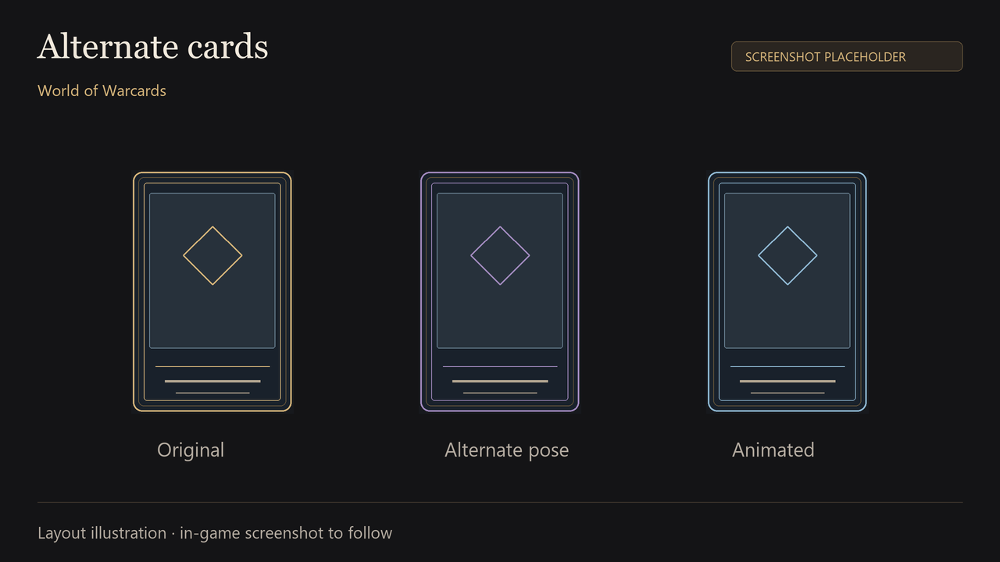
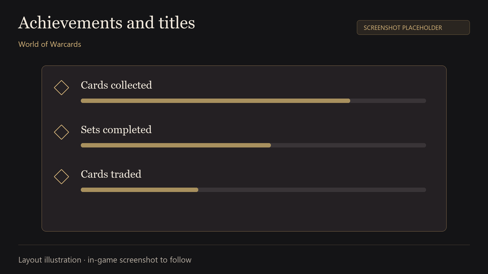
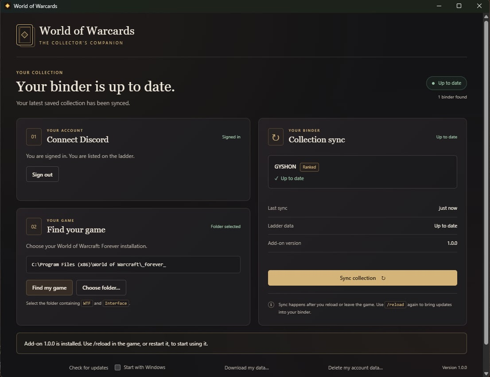

# World of Warcards

Find cards from mobs, dungeon bosses and gathering nodes while you play **World of Warcraft: Forever**. Keep them in your binder, open packs, trade your spares and work towards collection achievements.

**[Download](https://worldofwarcards.co.uk/download)** · **[Website](https://worldofwarcards.co.uk)** · **[Help](https://worldofwarcards.co.uk/help)** · **[Report a problem](https://github.com/Imokim2/azeroth-card-binder/issues/new/choose)**

Free and open source. Built for **Forever**; Retail and other Classic clients are not currently supported.

## Your collection, in game

Browse cards by zone or dungeon, see what you’re missing and take a closer look at your favourites. Some cards have separate collectible editions with different poses or animations.



*The gallery currently uses labelled layout illustrations. We’ll replace these with actual in-game screenshots.*

| Open packs | Trade or send a gift |
|:---:|:---:|
|  |  |
| Turn the cards over to see what you found. | Choose your offer. Both players accept before the trade completes. |

| Collect alternate editions | Earn achievements and titles |
|:---:|:---:|
|  |  |
| Find different versions of selected cards, including different poses and animations. | Complete sets and unlock titles other addon users can see. |

## Start collecting

1. Download the **addon ZIP** from [Downloads](https://worldofwarcards.co.uk/download) or [GitHub Releases](https://github.com/Imokim2/azeroth-card-binder/releases/latest). Use the release file, rather than GitHub’s “Code → Download ZIP”.
2. Close the game. Extract the `AzerothCardBinder` folder into your Forever installation:

   ```text
   World of Warcraft/
     _forever_/
       Interface/
         AddOns/
           AzerothCardBinder/
             AzerothCardBinder.toc
   ```

3. Enable **World of Warcards** in the character screen’s AddOns list. Open it from the minimap, or type `/acb`.

You can collect in **Casual** mode with just the addon. For **Ranked** play and online syncing, install the companion app too. The [setup guide](https://worldofwarcards.co.uk/help#install) covers both.

## The companion app

The Windows app connects your saved binder to the server. Sign in with Discord, choose your game folder and keep it running while you play. It syncs after `/reload` or logout and checks for addon and app updates.



- **Windows 64-bit.** Installs for your user without administrator rights.
- **Public or private.** Choose whether your binder appears on the website.
- **File-based syncing.** Reads the addon’s saved data and writes its update file; it does not read game memory or automate play.
- **Checkable downloads.** Release files include SHA-256 checksums. The companion verifies updates before installing them.

The current Windows installer is **not code-signed yet**, so Windows may show an unknown-publisher warning. See the [installation guide](https://worldofwarcards.co.uk/help#companion).

## Ranked play

Collect through normal play, use the addon’s trade window and keep your companion synced. Edited collections, fake progress and exploiting bugs are not allowed.

Read the [Ranked rules](https://worldofwarcards.co.uk/fair-play) **before starting a Ranked binder**. Casual drops affect eligibility. You can compare public collections on the [ladder](https://worldofwarcards.co.uk/ladder) and find possible swaps on the [wanted board](https://worldofwarcards.co.uk/wanted).

## Need a hand?

- [Setup and troubleshooting](https://worldofwarcards.co.uk/help)
- [Frequently asked questions](https://worldofwarcards.co.uk/faq)
- [Server status](https://worldofwarcards.co.uk/status)
- [Bug reports and feature requests](https://github.com/Imokim2/azeroth-card-binder/issues/new/choose)
- [Privacy and deleting your data](https://worldofwarcards.co.uk/privacy)

For security issues, follow [SECURITY.md](SECURITY.md). Avoid putting account files or personal information in a public issue.

<details>
<summary><strong>For contributors: source, builds and documentation</strong></summary>

The repository contains the addon, companion and server. The installed addon folder remains named `AzerothCardBinder` for compatibility with existing saved data and card links.

| Folder | Contents |
|---|---|
| `AzerothCardBinder/` | The addon, installed as it is |
| `app/` | Windows companion app, using Electron and TypeScript |
| `server/` | Cloudflare Worker, database migrations and website |
| `packages/shared/` | Shared catalog, ledger rules and test vectors |
| `tests/` | Offline Lua and shared-contract tests |
| `tools/` | Build, release, catalog and backup tools |
| `docs/` | Specifications, release planning and runbooks |

Use [LuaJIT](https://luajit.org) and [Node.js](https://nodejs.org) 24 or later. Install the app and server dependencies before running the full suite.

```sh
luajit tests/run.lua
node tools/release.js check
node tools/release.js test
node tools/release.js build
```

See [CONTRIBUTING.md](CONTRIBUTING.md), the [roadmap](docs/ROADMAP.md), [ledger specification](docs/LEDGER-SPEC.md), [API documentation](docs/API.md) and [release runbook](docs/runbooks/RELEASES.md). Client rendering, model poses, sounds and two-player interactions also need testing inside the game.

For the release-page draft and planned screenshots, see [CurseForge release planning](docs/launch/CURSEFORGE-PLAN.md). Image filenames and replacement instructions are in the [media guide](docs/media/README.md).

</details>

## Licence and credits

Copyright © 2026 the World of Warcards contributors. Licensed under **GPL-3.0-or-later**; see [LICENSE](LICENSE). Catalog sources and attribution are in [CREDITS.md](CREDITS.md).

World of Warcards is a fan project, not affiliated with or endorsed by Blizzard Entertainment. World of Warcraft and the Forever name belong to their respective owners.
