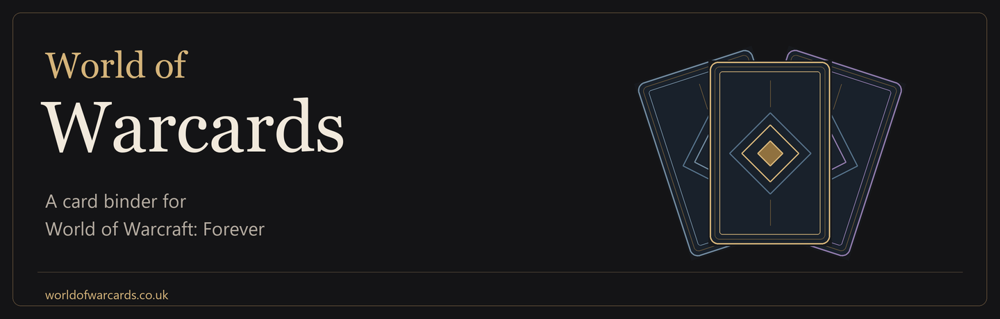
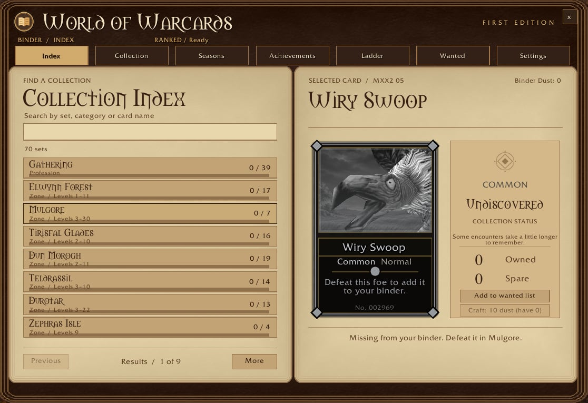
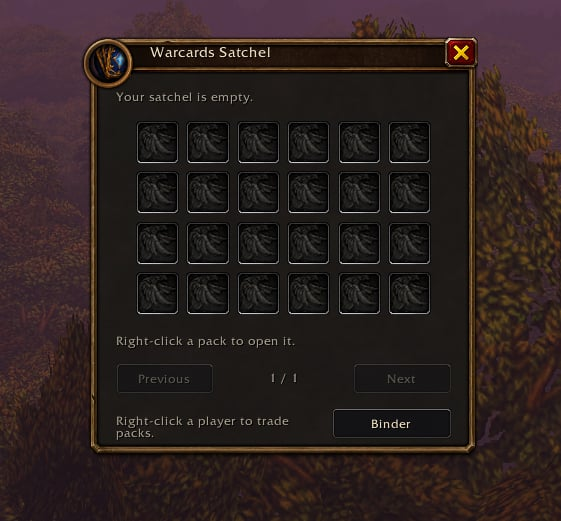
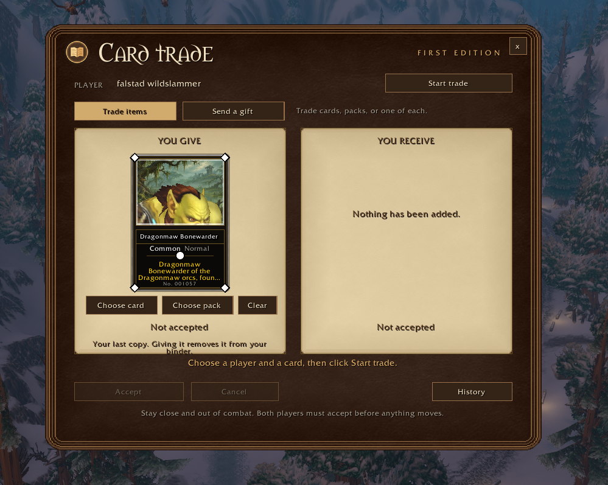
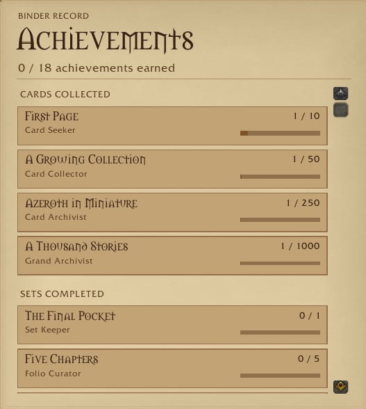
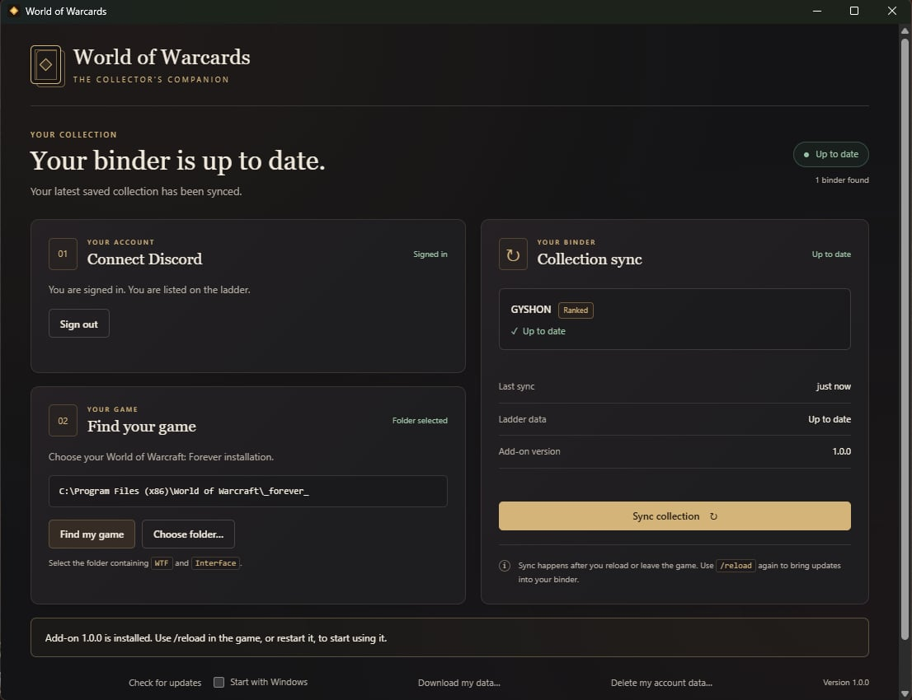

# World of Warcards

<!-- DESCRIPTION DRAFT ONLY. Do not submit until CURSEFORGE-PLAN.md is complete.
     Replace gallery illustrations with actual screenshots of the uploaded build.
     Upload images to the CurseForge gallery and use its returned image URLs;
     relative paths below let this draft be reviewed in GitHub. -->

Collect cards from mobs, dungeon bosses and gathering nodes as you play. Browse them in your binder, open packs, trade your spares and complete sets.

**Built for World of Warcraft: Forever.** Retail and other Classic clients are not currently supported.

## Your binder

Find cards across different zones and dungeons. Your binder shows the cards you own, the cards you’re missing and the spare copies you can trade.

## Open packs

Keep sealed zone packs in the Warcards Satchel. Common packs hold one card, Rare packs three and Epic packs five. Right-click a pack to open it and turn the cards over to see what’s inside.

<!-- Still needed: a real pack-opening capture with cards being revealed. -->

## Trade with friends

Right-click another player and choose **Trade cards or packs**. Swap a card or sealed pack for something you’re missing, or send a gift. The other player accepts the invitation, then both players review and accept the final offer.

## Collect alternate editions

Some cards have different poses and animations to collect alongside their original edition.

<!-- Still needed: an actual alternate-edition comparison screenshot. -->

## Achievements and titles

Complete sets and earn titles that other players using the addon can see.

## Seasonal collections

When a season is running, everyone gets the same list of cards to collect before the deadline. Find or trade for fresh copies alongside your normal Ranked binder. Complete the list for titles and packs, with extra rewards for the first finishers.

Some cards are held back from the launch collection and return through seasons. Once a season releases them, they stay available. Cards you already own are kept when the catalog changes.

<!-- Add an actual Seasons screenshot from the uploaded build before submission. -->

## Installation

Enable **World of Warcards** in the character screen’s AddOns list, then click the minimap button or type `/acb` to open your binder.

You can collect in **Casual** mode with the addon alone. **Ranked** play and online syncing use the separate Windows companion app. The companion syncs saved files after a reload or logout; it does not automate play.

When upgrading for Ranked play, update the companion before the addon. Keep your saved data: installing an update does not mean starting a new binder.

<!-- Obtain CurseForge guidance on describing the optional external companion and
     Forever compatibility before submission. Do not add direct external EXE links. -->

## Help and feedback

Please include your addon version, any error message and what you were doing when reporting a problem.

[Report a problem](https://github.com/Imokim2/azeroth-card-binder/issues/new/choose) · [Source code](https://github.com/Imokim2/azeroth-card-binder) · [Website and help](https://worldofwarcards.co.uk/help)

World of Warcards is free and open source under GPL-3.0-or-later. It is a fan project, not affiliated with or endorsed by Blizzard Entertainment.
