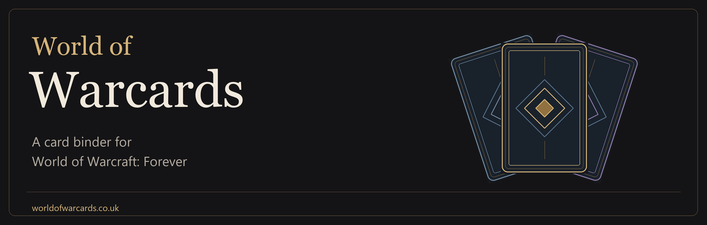
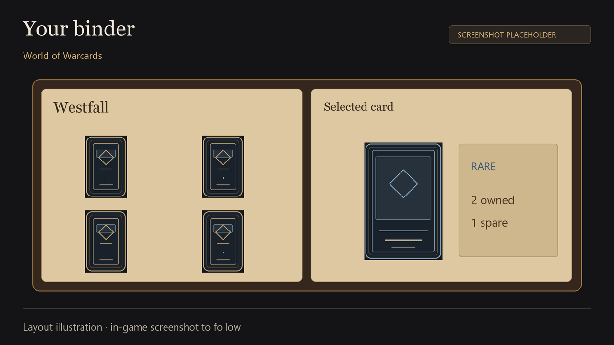
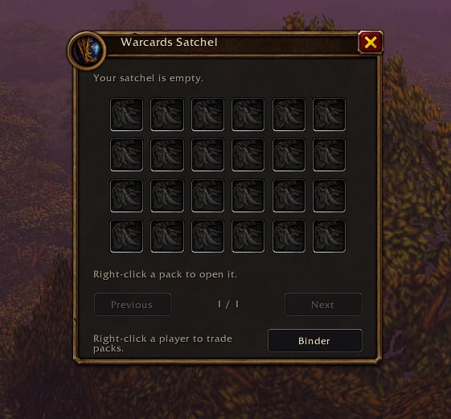
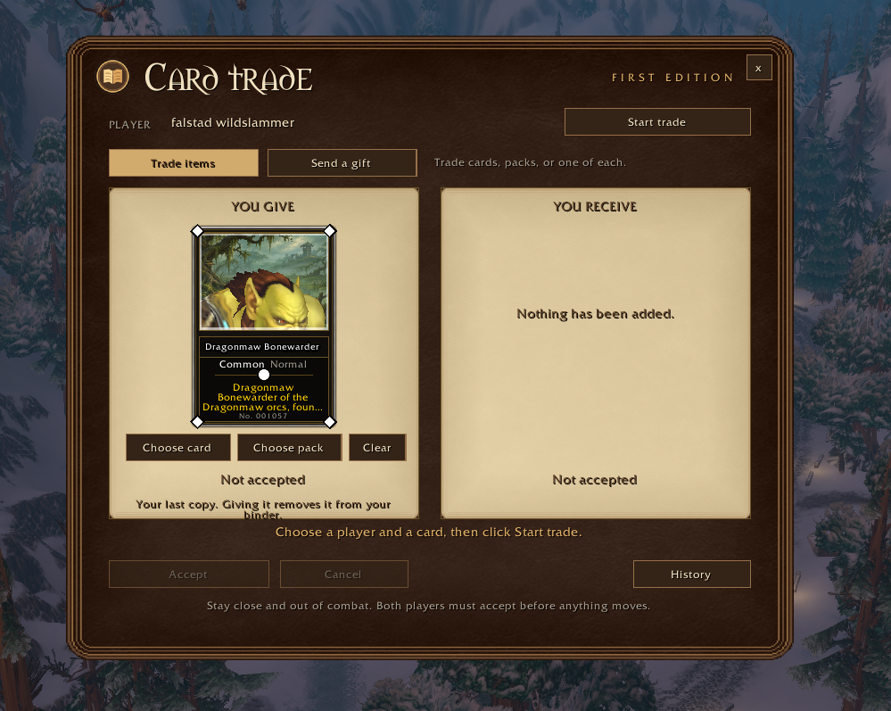
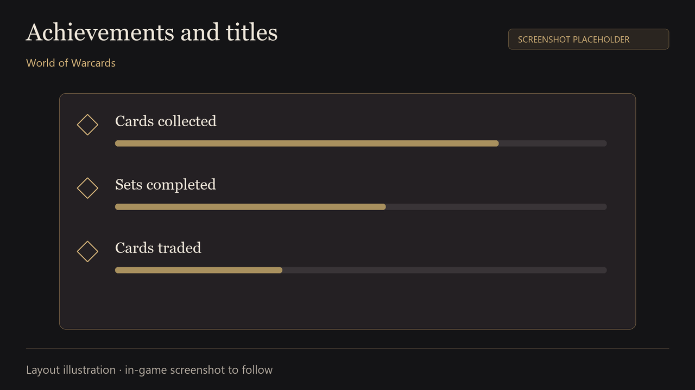
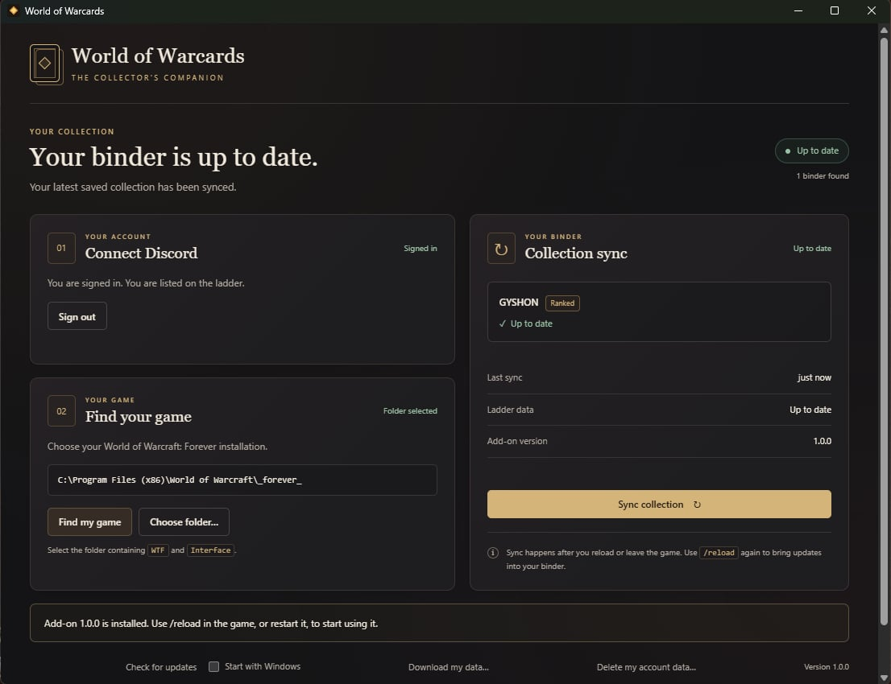

# World of Warcards

<!-- DESCRIPTION DRAFT ONLY — refreshed 15 November 2026.
     Describes released addon 1.0.13 with companion 1.0.1. Harry's pending card
     changes in PR #63 are recorded separately in CURSEFORGE-PLAN.md; do not
     advertise them as part of the current download. Use genuine release-build
     captures; upload them to the CurseForge gallery and replace these relative
     image URLs before submission. -->

Collect cards from creatures, dungeon bosses and gathering nodes as you play. Fill your binder, swap spares with friends or keep a zone pack sealed for a trade.

**Built for World of Warcraft: Forever.** Retail and other Classic clients are not currently supported.

## Your binder

Browse collections by zone or dungeon, see the gaps you still need to fill and take a closer look at your favourite cards. Search for a creature, set or category, then filter the index by **All**, **Owned** or **Unowned**.

The zone collection bar tracks your progress as you travel. Prefer the binder to open at the same place? Enable **Settings → General → Open binder at current zone**. It finds the current zone or dungeon collection, even with the bar hidden. In places without a matching collection, the binder remembers your previous page. The option starts off disabled.

Card links still take you straight to the selected card. Shift-click a card to share it in game; other players using the addon can open it in their own binder and see their own collection status.

## Open packs

Packs are named **Pack: Zone**, such as **Pack: Westfall**, and contain cards from that area. Common packs hold **one card**, Rare packs **three** and Epic packs **five**. The cards inside can be different rarities.

Sealed packs stay in the **Warcards Satchel**, a separate bag beside your normal bag controls. Right-click a pack to open it, then turn the cards over to reveal what you found. Or keep it sealed and offer it in a trade. Packs do not take up normal bag slots.

<!-- Still needed: a real pack-opening capture with cards being revealed. -->

## Trade with friends

Right-click another player and choose **Trade cards or packs**. Offer a card from your binder or a sealed pack from your satchel. Both players review the final offer and accept before anything moves.

Sending a gift works the same way: the receiving player leaves their side empty, and both players accept. Mark missing cards in your **Wanted** list to make it easier to find a swap.

Both players need the companion set up and a **Ranked** binder. Trading and gifting are disabled in Casual. Cards and packs are addon-owned items, so trades use the Warcards window rather than the game's mail or auction house.

## Collect alternate editions

Some cards have separate collectible editions with different poses or animations. Inspect the 3D portrait and rotate it by hand; rarer cards and special editions can have extra movement or looping animations.

<!-- Still needed: an actual alternate-edition comparison screenshot. -->

## Achievements and titles

Work towards achievements for collecting cards, finishing sets and trading. Earn and equip binder titles that other players using the addon can see in your tooltip.

## Seasonal collections

When a season is running, everyone gets the same list of cards to collect before the deadline. Seasons run alongside your normal Ranked binder: fresh copies earned from drops, packs or trades can count towards both collections.

Copies you owned before the season started do not fill its slots. Everyone who finishes in time receives the listed rewards, with extras for the first finishers. Keep the companion running and save and sync before the deadline so your progress is recorded.

Some cards are held back from the launch collection and return through seasons. Once a season releases them, they stay available. Cards you already own are kept when the catalog changes.

<!-- Add an actual Seasons screenshot from the uploaded build before submission. -->

## Getting started

1. Put the **AzerothCardBinder** folder inside **Interface/AddOns** in the Forever installation you actually launch. The `.toc` file should be directly inside that folder.
2. Enable **World of Warcards** in the character screen's AddOns list. Open the binder from the minimap button or type `/acb`. Open the satchel with `/acb bag`.
3. Choose your collection mode before finding your first card.

**Casual** works with the addon alone. **Ranked** uses the separate Windows companion for trading, gifting, seasons and the online ladder. Sign in through Discord, choose your game folder and keep the companion running while you play. It syncs after `/reload` or logout; it does not automate gameplay.

For Ranked setup, `/reload`, wait for the companion to finish syncing, then `/reload` again to load the returned setup. Check that the binder says **RANKED / Ready** before collecting. A successful sync does not convert cards already found in Casual into Ranked cards.

Install matching addon and companion updates, updating the companion first when a release requires it. **Updates keep your cards, packs and saved progress.** Keep your game's `WTF` folder and existing saved data. Starting a new binder is a separate, deliberate choice.

<!-- Keep the companion description factual and the homepage link in the footer.
     Do not add direct external EXE links or bundle an installer with the addon. -->

## Make it comfortable

In **Settings**, choose whether to show card pop-ups, tooltip hints, the zone bar and 3D portraits. Switch pickup, pack, trade and window sounds on or off separately. Shift-drag the satchel button to move it.

The **Chat** page has optional guild announcements for card and pack finds. Choose a minimum rarity for guild card messages so every common find does not fill guild chat.

## Known issue: loading screens

Some Forever players using DirectX 12 have reported stuck loading screens with repeated desktop flickering. **Warcards' 3D models may make this issue more likely or worse.** The bounded model preloader added in 1.0.10 reduces graphics-resource use, but is **not a confirmed fix**.

**If it happens:** press Enter, type `/reload` and press Enter again if chat still responds. This has recovered an affected session, but is not guaranteed. If it fails, close the game with Alt+F4 and relaunch it. Forced closure can lose finds since the last normal save. You can also turn off **3D card models** in Settings to reduce model work.

See the [known issues and troubleshooting steps](https://github.com/Imokim2/azeroth-card-binder/blob/main/KNOWN-ISSUES.md) before installing. We are still investigating; the matching client reports do not establish an official diagnosis or a confirmed Blizzard fix.

## Help and feedback

Open **Settings → Help → Report a bug** in the binder and copy the link into your browser. It includes basic game details; add what happened and what you were doing. You do not need to diagnose the cause first. Please include your companion version if you know it.

Join the **World of Warcards Discord** for setup help, bug reports, known issues and update notices. Show off your binder, find people to trade with or talk about the next season.

[Community Discord](https://worldofwarcards.co.uk/discord) · [Report a problem](https://github.com/Imokim2/azeroth-card-binder/issues/new/choose) · [Source code](https://github.com/Imokim2/azeroth-card-binder) · [Website and help](https://worldofwarcards.co.uk/help)

World of Warcards is free and open source under GPL-3.0-or-later. It is a fan project, not affiliated with or endorsed by Blizzard Entertainment.
